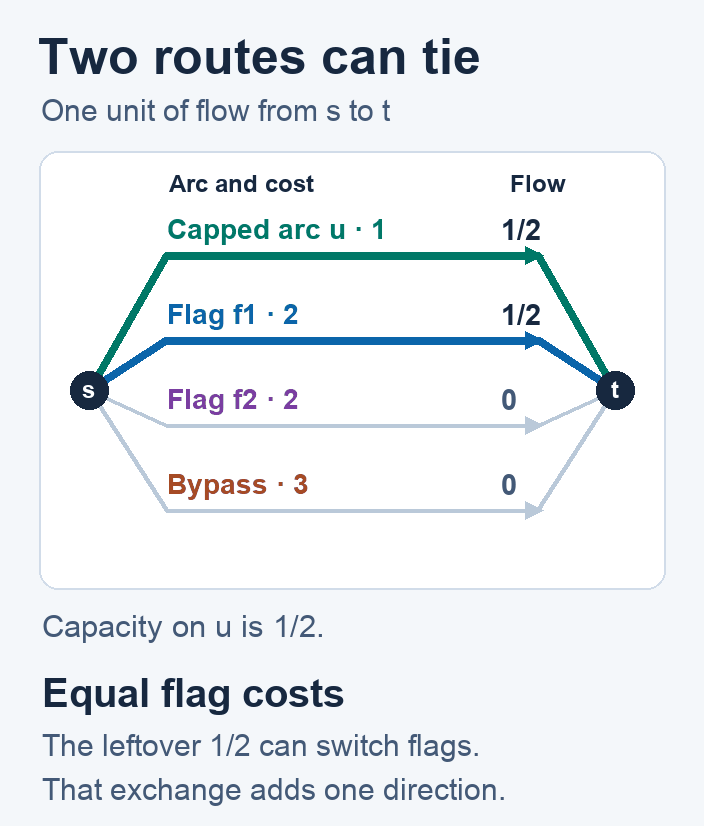

# Minimum measurement dimension for capacitated network flows

  

How many linear measurements of an unknown cost vector determine the full optimizer set? Computing that number and constructing a minimum dataset are NP-hard under polynomial-time Turing reductions, even for nondegenerate directed acyclic flows with a single capacitated arc. Verifying a supplied dataset is coNP-complete under many-one reductions. The empty dataset can be checked in polynomial time.

[Read the paper](paper/manuscript.pdf) · [LaTeX source](paper/manuscript.tex) · [Proof outline](proof/PROBLEM_AND_PROOF.md) · [Run the replay](REPRODUCIBILITY.md)

## Why a tied pair can need another measurement

A capped arc carries 1/2 unit, leaving 1/2 for two equally priced uncapped arcs. Swapping that flow between the two flags keeps their sum fixed and contributes an independent direction. Making one flag strictly cheaper removes this choice. If the bypass is cheapest, neither flag carries flow. The proof compares two open priors on the same polytope.

[Download the offline explorer](https://raw.githubusercontent.com/DannyExperiments/minimum-measurement-dimension-flows/refs/tags/v1.0.0/visualization/flow-measurements-explorer.zip), extract it, and open index.html. [Figure guide](visualization/README.md)

## Sources and verification

The question appears in [Ye, Amin and Özdağlar, COLT 2026, §7](https://proceedings.mlr.press/v336/ye26a.html) and [catalog Q438](https://github.com/10m-u/open-problems-catalog/blob/ca8d4d44ba3db527f19f28928c240168f545ecfe/problems/mathematics/optimization-operations-research.md#q438). The reduction uses the inverse shortest-path construction of [Ley and Merkert](https://doi.org/10.1007/s10898-025-01529-x) and the geometric characterization of [Bennouna et al.](https://arxiv.org/abs/2505.21692). The replay checks 80 path fixtures, 59,048 signed right-hand-side patterns, and the illustrated nondegenerate flow.

[Mathematical audit](audits/public_safe_reports/MATHEMATICAL_AUDIT.md) · [Literature audit](audits/public_safe_reports/LITERATURE_AUDIT.md) · [Scope](CLAIM_SCOPE_AND_LIMITATIONS.md) · [AI disclosure](AI_DISCLOSURE.md) · [Status](STATUS.md)

[Release v1.0.0](https://github.com/DannyExperiments/minimum-measurement-dimension-flows/releases/tag/v1.0.0) · [Version DOI](https://doi.org/10.5281/zenodo.24570846) · [Citation](CITATION.cff)

## Lean verification

An integer combination of consecutive powers of four with coefficients in {−1, 0, 1} vanishes exactly when all its coefficients vanish. Clearing a common denominator gives this form for combinations of the internal-vertex demands. The basis arguments, separate large right-hand-side entries, and complexity theorems are proved in the paper. [Lean source and replay](formalization/README.md)
